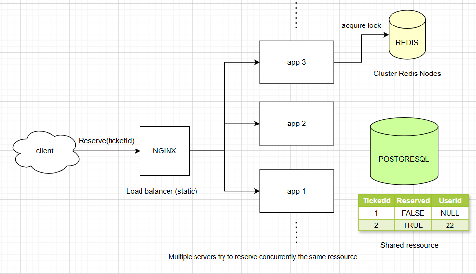

# Seatwise

A concurrency-safe ticket reservation system. Multiple application instances sit behind an Nginx load balancer and compete for the same tickets, while a Redis distributed lock (Redisson) guarantees that each ticket is reserved **exactly once**, even under simultaneous requests.

**Stack:** Java 17 · Spring Boot 3.1.3 · PostgreSQL 14 · Redis + Redisson · Nginx · Docker Compose · Prometheus metrics

Maintained by [@iamrishiraz](https://github.com/iamrishiraz)

---

## Features

- **Distributed locking:** a Redisson `RLock` per ticket (`ticket-lock-{id}`) prevents double booking across separate app instances
- **Horizontal scaling:** two app instances behind Nginx (round-robin), easy to extend
- **Persistence:** PostgreSQL via Spring Data JPA, schema auto-created on first start
- **Containerized:** one command brings up the whole stack
- **Observability:** Spring Boot Actuator health and Prometheus metrics
- **Verified under load:** 20 concurrent requests across two instances produced exactly one successful reservation (see [Concurrency test](#concurrency-test))

## Architecture



| Component | Role |
|---|---|
| Nginx | Load balancer, distributes traffic across the app instances |
| app1, app2 | Spring Boot instances, identical, each handles reservation requests |
| Redis | Holds the distributed locks shared by all instances |
| PostgreSQL | Stores tickets and their reserved state |

**Request flow:** a request reaches an instance, which acquires the Redis lock for that ticket (waiting up to 5 seconds), checks whether the ticket is already reserved, marks it reserved if not, and releases the lock. The lock auto-expires after 30 seconds if an instance dies while holding it.

## Getting Started

### Prerequisites

- Docker Desktop (running) with Docker Compose
- Java 17+ and an IDE such as IntelliJ (only needed to run outside Docker)

### Run the full stack (recommended)

```bash
git clone https://github.com/iamrishiraz/seatwise.git
cd seatwise
docker compose up -d --build
```

The first build takes a few minutes. Check that everything is up:

```bash
docker compose ps
```

| Service | URL / Port |
|---|---|
| API (through Nginx) | http://localhost |
| app1 | http://localhost:8081 |
| app2 | http://localhost:8082 |
| PostgreSQL | `localhost:5433` (container port 5432) |
| Redis | `localhost:6379` |

> PostgreSQL is mapped to host port **5433** so it doesn't clash with a PostgreSQL already installed on your machine (which usually owns 5432).

### Add some tickets

The database starts empty. The app creates the `ticket` table on first start, so once the containers are up, insert a few tickets:

```bash
docker compose exec postgres psql -U postgres -d tickets -c "INSERT INTO ticket (reserved) VALUES (false);"
```

Run it once per ticket you want. IDs are assigned automatically (1, 2, 3, ...).

### Run from your IDE instead

Useful for debugging. Start only the data stores:

```bash
docker compose up -d postgres redis
```

Then run `com.Aabdane.ReservationApplication` with:

- **Environment variables:**
  ```
  SPRING_DATASOURCE_URL=jdbc:postgresql://127.0.0.1:5433/tickets;REDIS_HOST=127.0.0.1;REDIS_PORT=6379
  ```
- **VM option:** `-Duser.timezone=Asia/Kolkata` (see [Troubleshooting](#troubleshooting))

The app then listens on http://localhost:8080.

## API

| Method | Endpoint | Description |
|---|---|---|
| `POST` | `/tickets/reserve/{id}` | Reserve a ticket |
| `GET` | `/actuator/health` | Health check |
| `GET` | `/actuator/metrics` | Metrics |
| `GET` | `/actuator/prometheus` | Prometheus scrape endpoint |

**Example:**

```bash
curl -X POST http://localhost/tickets/reserve/1
```

On Windows PowerShell, use `curl.exe` instead of `curl`.

**Possible responses:**

| Response | Meaning |
|---|---|
| `Ticket reserved successfully` | This request got the ticket |
| `Ticket already reserved` | Someone else got it first |
| `Could not acquire lock, please try again later` | Lock wait timed out (5 s) |
| `Error: Ticket not found: {id}` | No ticket with that ID |

## Concurrency test

The point of the project: many simultaneous requests for one ticket, exactly one winner.

**Bash / Git Bash / WSL** (uses the included script, which targets port 80):

```bash
./test-concurrent.sh <ticket-id> <num-requests>
./test-concurrent.sh 2 20
```

**PowerShell:**

```powershell
1..20 | ForEach-Object { Start-Job { curl.exe -s -X POST http://localhost/tickets/reserve/2 } } | Wait-Job | Receive-Job
Get-Job | Remove-Job
```

**Result from my run** (20 requests through Nginx against one ticket, two app instances):

- 1 × `Ticket reserved successfully`
- 19 × `Ticket already reserved`
- Nginx split the load evenly: 10 requests per instance
- Lock acquire/release lines in both instances' logs never overlapped, showing the Redis lock coordinating across containers

Inspect the per-instance logs with:

```bash
docker compose logs app1 | findstr /C:"ticket: 2"     # Windows
docker compose logs app1 | grep "ticket: 2"           # macOS / Linux
```

## Tests

```bash
./gradlew test
```

The tests use Testcontainers, so Docker must be running.

## Project structure

```
src/main/java/com/Aabdane/
├── ReservationApplication.java      # Spring Boot entry point
├── ReservationService.java          # Locking + reservation logic
├── controller/ReservationController.java
├── entity/Ticket.java
├── repository/TicketRepository.java
└── config/                          # Redisson client + lock metrics
```

Other key files: `docker-compose.yml` (stack), `Dockerfile` (multi-stage build), `nginx.conf` (load balancer), `.github/workflows/ci.yml` (CI).

## Troubleshooting

| Problem | Fix |
|---|---|
| `failed to connect to the docker API ... dockerDesktopLinuxEngine` | Docker Desktop isn't running. Start it and wait for "Engine running". |
| `no configuration file provided: not found` | Run `docker compose` from the project folder (where `docker-compose.yml` lives). |
| `password authentication failed for user "postgres"` | Another PostgreSQL (often a local Windows install) is answering on port 5432. Use the Docker one on port 5433 as configured here. After changing ports, run `docker compose down -v` once to reset the volume. |
| `invalid value for parameter "TimeZone": "Asia/Calcutta"` | Newer PostgreSQL rejects the legacy timezone name. Run the app with `-Duser.timezone=Asia/Kolkata`. |
| `openjdk:17-slim: not found` during build | The `openjdk` base image was removed from Docker Hub. This repo's Dockerfile uses `eclipse-temurin:17-jre`. |
| `Connection to 127.0.0.1:5433 refused` | The database container isn't running. Run `docker compose up -d postgres redis`. |

## My changes to this project

Seatwise started from an open-source ticket reservation example. What I did on top of it:

- Fixed the Docker build: replaced the removed `openjdk:17-slim` runtime image with `eclipse-temurin:17-jre`, and switched to `bootJar` so a single runnable jar is produced
- Resolved a PostgreSQL port conflict by mapping the container to host port 5433
- Set up and documented running the stack both fully in Docker and from the IDE
- Ran and documented a concurrency test across two instances behind Nginx, with log analysis confirming cross-instance lock behavior
- Rewrote this README to match the real API (`/tickets/reserve/{id}`), which previously described endpoints and Gradle tasks that don't exist
- Renamed the project to Seatwise

## Known limitations and roadmap

- **Single-node lock:** the code uses a standard Redisson `RLock` on one Redis server. That is solid for this setup, but it is not the multi-node Redlock algorithm.
- **Transaction timing:** `reserveTicket` is `@Transactional`, so the database commit happens after the lock is released. There is a very small window where another request could read the old value. Fix: commit inside the lock (for example with `TransactionTemplate`).
- **No release endpoint:** the service has `releaseTicket`, but no controller route exposes it.
- **No seed data or health checks:** tickets are inserted manually, and the compose file has no startup ordering (app containers may need `docker compose restart app1 app2` if they start before Postgres is ready).
- **Config:** database credentials are hardcoded for local development; move them to environment variables or secrets before any real deployment.

## Acknowledgements

Based on an open-source ticket reservation project originally written by **Aabdane** (the Java package `com.Aabdane` comes from that work). Original repository: *add link here*.

Thanks to the original author for the foundation.